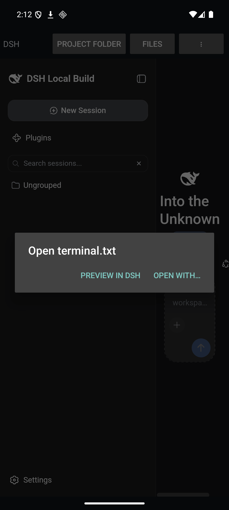
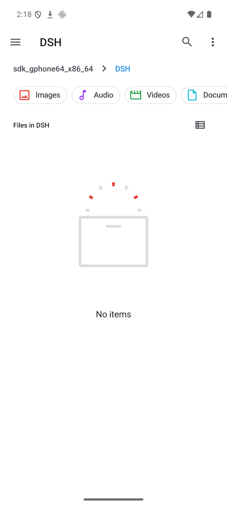

# DeepSeek Harness for Android

A port of [DeepSeek Harness](https://github.com/deepseek-ai/deepseek-harness) (DSH) to
Android, delivered as an installable application. The phone runs the Harness itself: the
agent loop, the tools, the session log, and the Web UI all execute on the device, with no
desktop host, no Termux, and no companion process anywhere else.

Download: [DSH for Android 0.1.4](https://github.com/QwenchC/dsh-android/releases/tag/v0.1.4)
(debug-signed APK, arm64-v8a + x86_64, Android 8.0+). See the
[release notes](docs/releases/v0.1.4.md) for tested environments and remaining limits.

```
┌──────────────────────────────────────────────────────────────────────┐
│ Android application (com.dsh.android)                                │
│                                                                      │
│  MainActivity ── WebView ──▶ http://127.0.0.1:<port>/                │
│       │                            ▲                                 │
│       │ state / control            │ the Web UI served by DSH        │
│       ▼                            │                                 │
│  DshService (foreground) ──▶ DshRuntime ──▶ node (libnode.so)        │
│                                    │           dsh web --no-open     │
│                                    ▼                                 │
│                    /data/data/com.dsh.android/files/dsh              │
│                      runtime/   the Harness tree                     │
│                      home/.dsh  sessions, settings, credentials      │
│                      workspace/ what the agent edits                 │
└──────────────────────────────────────────────────────────────────────┘
```

## Why the port is shaped this way

Four Android facts decide the architecture, and each one is answered by a specific piece of
the port rather than by a workaround:

| Android fact | Consequence | How the port answers it |
|---|---|---|
| An application may only `execve` code the installer extracted from the APK (Android 10 removed execute permission from the app home directory) | The Node executable cannot live in the writable runtime tree | The runtime ships as native library entries — `libnode.so`, `librg.so`, `libbash.so` — and `useLegacyPackaging` keeps them extracted on disk |
| The platform extracts a native library only when its name starts with `lib` and ends with `.so` | `libssl.so.3`, `libicuuc.so.78`, `libz.so.1` cannot travel as native library entries | They keep the names their SONAMEs require, travel inside the runtime archive, and are found through `LD_LIBRARY_PATH` — rewriting an ELF's string table to rename them produces an object Android's linker rejects |
| No official Node.js build targets Android, and nodejs-mobile stopped at Node 18 while DSH requires `^22.19.0 \|\| >=24.0.0` | The runtime must be obtained or built outside the normal channel | Node 24.18.0 LTS is repackaged from the Termux build (the only maintained Android Node >= 22), relocated with `patchelf` |
| A process runner that confines commands has no Android rung, and DSH fails closed rather than running unconfined while claiming otherwise | The default Sandboxed bash executor would refuse every command | The Android surface mounts the unconfined executor and states the boundary in composition, so the default policy matches what actually runs |
| Android denies `link(2)` inside application data, and the Harness publishes session logs, attachments, and guarded writes without replacement | The first append, the first guarded write, and every attachment would fail | `publishNoClobber` keeps the hard link as its primitive and falls back to an exclusive create plus copy, which preserves both the no-clobber guarantee and the `EEXIST` answer |
| Android 15 draws every application edge to edge, and the Harness UI is a full-window surface | The status and navigation bars would sit over the interface | The activity applies the system-bar and keyboard insets to its root view, so the WebView stays between them |
| No PTY provider ships for Android, and the platform has no `/bin/bash` | The persistent terminal and the shell executor would have nothing to run | node-pty is built for both ABIs into `prebuilds/android-<arch>/`, and bash is repackaged from Termux |

## What the port adds to DSH

The Harness is a Cordis plugin tree, so the Android surface is composition rather than a
fork. Everything below is a small, self-contained change; nothing rewrites an existing
subsystem.

| Path | Change |
|---|---|
| `packages/bundle/android-app/` | **New.** The Android surface as a profile bundle: the Android sandbox policy, the unconfined shell executor, the platform shell path, and the rows for capabilities Android does not have |
| `packages/boot/app-boot/src/profile.ts` | Ships the `android` profile: `dsh-base` + `dsh-web-app` + `dsh-android-app` |
| `packages/shell/bash-local/src/index.ts` | Adds the `executable` config field (default `bash`); Android names `/system/bin/sh` or a bundled bash |
| `packages/shell/bash-sandbox/src/index.ts` | The sandboxing executor honours the same field |
| `packages/sandbox/sandbox-local/src/index.ts` | Declares `android: []` in the platform chains, so an unsupported runner fails closed loudly instead of being probed |
| `packages/fs/tool-fs-search/src/*` | Adds the `ripgrepPath` config field, because `@vscode/ripgrep` publishes no Android build |
| `packages/preset/agent-presets/presets/{standard,cordis,ptc}` | Pass `DSH_RIPGREP_PATH` into `tool-fs-search`, the same way the compositions already read `DSH_PERMISSION_MODE` |
| `packages/boot/app-boot/src/profile-resolution/resolver.ts` | Reaches Node internals through `--expose-internals` before the native binding, which publishes no Android build |
| `packages/bundle/base/cordis.patch.yml` | Gates the sandboxed executor, the policy default, the permission presets, and the ripgrep path for Android, so every profile — not just `android` — composes correctly there |
| `packages/util/atomic-write/src/index.ts` | Adds `publishNoClobber`: hard-link publication with a fallback for platforms that refuse links, which Android does |
| `packages/fs/fs-local`, `packages/session/session-persistence-jsonl`, `packages/attachment/attachment-local` | Publish guarded writes, session logs, and attachments through that primitive |
| `native/system/packages/android-arm64`, `android-x64` | **New.** The flock Node-API addon built against bionic; a Session's write lock is the one native primitive the Harness needs |
| `native/system/packages/entry/src/flock.ts` | Resolves the Android payload (`bin/bionic/system.node`) instead of rejecting the platform |
| `scripts/build-node-pty.ps1` | Builds node-pty for Android (both ABIs) into `prebuilds/android-<arch>/`, where its loader looks and where its `spawn-helper` is found beside it |
| `packages/bundle/base/cordis.patch.yml` | Mounts the PTY backend on Android with the bundled bash as the interactive shell |
| `packages/ptc-runtime/ptc-runtime-node/src/environment.ts` | Keeps `LD_LIBRARY_PATH` and `TMPDIR` among the startup variables the `run_code` worker inherits: the worker deliberately drops the ambient environment, and without the loader path the child Node cannot link at all on Android |
| `native/system/packages/entry/package.json`, `apps/cli/package.json`, `tsconfig.host.json` | Register the new packages in the installation closure and the build graph |

## Build

The current toolchain is JDK 21, Android SDK 37, Gradle 9.8.1, and pinned **AGP
9.5.0-alpha09 (preview)**. This AGP version and a pinned KGP 2.4.21 build dependency
remove upstream Gradle deprecations; the Java-only app disables Kotlin compilation
through the module DSL. See [toolchain validation](docs/verification.md#15-agp-and-kotlin-build-deprecations--2026-10-15)
for the preview-version tradeoff and strict verification checks. Java compilation also
rejects deprecated platform APIs. See [platform compatibility results](docs/verification.md#16-android-platform-api-deprecations-and-compatibility--2026-10-15)
for the 0.1.3 migration and Android 8/16/17 tests. The [Android 8 UI acceptance](docs/verification.md#17-android-8-webview-and-production-ui-acceptance--2026-10-15)
records the compatible provider, real model approvals and the 0.1.4 mobile-settings fix.

Everything is driven from this directory. The build host is Windows with WSL2; WSL performs
the ELF work, PowerShell drives the packaging.

```powershell
# 0. Prepare the pinned upstream source and apply both port patches once
git clone https://github.com/deepseek-ai/deepseek-harness.git dsh-harness
git -C dsh-harness checkout ddefc45fbc7f8e46dd73185e68295696d1297887
git -C dsh-harness apply ../patches/android-port.patch
git -C dsh-harness apply ../patches/android-mobile-settings.patch

# 1. The Node runtime for Android (Termux packages, relocated for the APK)
wsl -d Ubuntu-24.04 -u root -- bash /mnt/e/Lumi/DSH-Android/scripts/build-node-runtime.sh

# 2. The native flock payloads
powershell -File scripts/build-android-native.ps1

# 3. Build the Harness and deploy a self-contained tree
cd dsh-harness
pnpm install
pnpm run build:lib
pnpm run build:web
pnpm --filter @deepseek-ai/dsh deploy --prod --legacy --config.node-linker=hoisted ..\dist\dsh-hoisted

# 4. Assemble the application payload (native entries + Harness archive)
powershell -File ../scripts/package-app.ps1 -Abi arm64-v8a -NodeAbi arm64

# 5. Build the APK
cd ../android-app
.\gradlew.bat assembleDebug
```

## Runtime layout on the device

| Path | Contents |
|---|---|
| `<nativeLibraryDir>/libnode.so` | The Node 24 runtime (a renamed executable, not a library) |
| `files/dsh/runtime/nativelib/<abi>/` | ICU, OpenSSL, c-ares, SQLite, zlib and the tools' libraries, under the file names their SONAMEs name |
| `<nativeLibraryDir>/librg.so` | ripgrep, for the `glob` and `grep` tools |
| `<nativeLibraryDir>/libbash.so` | bash, the shell the executor and the terminal run |
| `files/dsh/runtime/` | The Harness tree, the native addon payload, and node-pty's per-ABI binding, extracted from `assets/dsh-runtime.zip` on first launch |
| `files/dsh/home/.dsh/` | `$DSH_HOME`: sessions, settings, credentials, profiles |
| `files/dsh/workspace/` | The default working directory, or wherever the user switches it |
| `files/dsh/dsh.log` | The runtime's combined output, also shown in the in-app log view |

## Getting at the files the agent wrote

Three facts shape this. An application's private directory cannot be shown by any
file manager or opened by any viewer; the code that lets another application read
one file is a per-URI grant rather than a permission; and since Android 11 a
package that the application has not asked about is invisible to it, which makes
an otherwise correct intent fail.

**The application's own row sits above the page, not over it.** The bar carries
the project folder, the file list, and the actions that used to live in an
options menu no activity bar ever showed — so nothing overlaps the interface.



- **`Project folder` opens the device's file manager at the workspace.** A
  folder on shared storage has a document URI any file manager understands, and
  the intent lands inside it. A folder private to the application has no such
  URI and nothing outside the sandbox can list it, so the action says that
  instead and offers the grant and the move that fix it.

  

- **A file reference in a conversation asks how to open.** The Harness renders
  one as a button carrying the path; the page hands that path to the
  application, which asks `Open with…` — the platform chooser, so a chosen
  default is remembered — or `Preview in DSH` for the in-product view.
- **`Files` lists the workspace in the application.** Directories first, sizes
  beside names, a tap opening the file with the device's preferred application
  and a long press offering the explicit chooser. This is the only way into a
  private workspace, and it says so when the workspace is private.
- **After selecting the shared workspace and restarting, the Harness's own home is the shared
  folder.** The Harness's directory picker offers its process home as *Home*,
  and a project created there is what the user expects to find in a file
  manager. So `HOME` points at `/sdcard/DSH` after selecting that workspace and restarting, and new
  projects are visible outside the application from the moment they exist.
  `DSH_HOME` does not move: sessions and credentials stay private.
- **The copy action stops the Harness and verifies real projects.** A project lives
  either in the application's own workspace or in a directory under the Harness
  home, so both are copied — the workspace's contents, and each home directory
  as a directory that keeps its name. Existing files are skipped only when their SHA-256 content matches. Conflicts or failures
  prevent changing the workspace; original files and the Harness state directory are retained.
  Start the Harness again after a successful copy. Earlier sessions retain their original paths.

  ```
  /sdcard/DSH
    app-project/index.ts        from the workspace
    notes.txt                   from the workspace
    myproject/readme.md         from the harness home, name preserved
    myproject/src/main.js
  ```
- **What the provider serves is the workspace and nothing else.** Session logs,
  settings, credentials, and the extracted runtime share the same subtree and
  are refused by canonical-path containment, which is tested below.
- **The manifest declares what it needs to reach.** `<queries>` names the
  document providers and the view and share intents, because an implicit intent
  to a package the application never asked about resolves to nothing.

## Diagnosing a failure on a device

An application that only crashes is an application nobody can report. A fatal
failure is written to `files/dsh/crash.log` and shown at the bottom of the
**Log** screen, so the trace can be read and copied on the phone itself —
without a host, a cable, or a debug build. Debug builds also offer *Simulate a
crash* in the actions menu, which is how that path is tested.

Actions that hand work to another application refuse rather than die: if no file
manager answers, or one rejects the folder URI, the next spelling of the request
is tried and the application's own file list is the last resort.

## Running with the screen off

Version 0.1.4 includes cancellable startup, verified project copying, per-tool confirmation,
and an origin-restricted WebView bridge. See [Android reliability and permissions](docs/android-hardening.md)
for behavior, restart requirements, and repeatable tests. The default is **Require confirmation**;
**Autonomous execution** is an explicit native-menu opt-in that takes effect after Stop/Start.
Commands still execute with the application's Android permissions.

A foreground service keeps the *process* alive; it does not keep the *processor*
alive. Once the screen goes off the device suspends, the event loop stops
turning, and a model request stalls mid-stream until something wakes the device.
The application therefore holds a partial wake lock while the Harness runs, with a
five-minute timeout renewed each minute, and states that cost in its notification.

Two consequences worth knowing:

- **The lock is released when the Harness stops** — from the application's
  *Stop harness* menu action, or when the runtime exits. Nothing keeps the
  processor awake once nothing is running.
- **Network access in deep idle is a separate permission.** The platform defers
  network for an idle application even with a wake lock held. The
  *Battery: unrestricted* menu action opens Android's battery optimization list;
  the user selects DSH and decides whether to grant an exemption there.

## Limitations

These are properties of running the Harness inside an Android application, not defects in
the port. Each one is either a missing platform capability or a deliberate refusal to claim
something the platform cannot back up.

- **Command execution is unconfined.** The Session file-effect policy still applies to every
  file tool through the in-process fence, but a command the model runs has the application's
  own authority. The alternative — the Sandboxed bash executor — fails closed on Android
  because there is no bubblewrap, no Seatbelt, and no enforcing Landlock for an application
  process, and a Harness that ran commands unconfined while reporting them as confined would
  be lying. The Android application sandbox (a unique uid with no access outside its own
  directories) is the real boundary.
- **The Web UI requires a compatible WebView.** Stock Android 8 Chrome/WebView 69
  cannot parse the bundled JavaScript. Full page rendering and real-model approvals
  passed on API 26 x86_64 with Chrome/WebView **119.0.6045.194**; this is a frozen
  compatibility-test provider, not a currently security-supported browser. The tested
  138/132 x86_64 libraries fail to load on that old image. See the dated acceptance
  record before reproducing this environment; ARM64 Android 8 hardware is unverified.
- **Image attachments are unavailable.** `sharp` publishes no Android build, so raster
  normalization fails at the first image. Text and document attachments work.
- **Office document conversion is off.** The bundled LibreOffice engine is a desktop binary.
- **"Open In..." is off.** Android has no desktop application registry to resolve.
- **Shared storage needs a grant and Android 11+.** The default workspace is app-private. Choosing a folder
  on `/sdcard` requires the all-files-access permission, which the app requests from its
  menu; without it Android's scoped storage hides those directories from the picker.

## Verification

On the x86_64 emulator, in the application's own environment:

```
node    : v24.18.0 on android-x64
ripgrep : ripgrep 15.2.0
bash    : bash 5.3.9(1)-release
flock   : acquired the Session write lock
publish : published (no-clobber)
publish : second attempt refused with EEXIST
pty     : interactive shell answered on the PTY
```

and the Harness itself, from the application's log:

```
[runtime] installed 14539 entries
[runtime] .../lib/x86_64/libnode.so --expose-internals .../runtime/lib/bin.js web --host 127.0.0.1 --port 43217 --no-open
dsh web: http://127.0.0.1:43217/?token=NTODnmxWkExND1FXNYs3ZpfGy7oyFP8CQ0V7ej3NCUU
```

The browser application then renders in the application's WebView from that
loopback origin, and a real agent turn runs end to end: given "create notes.txt
whose only line is the output of pwd, then confirm it with your search tool", the
device's model adapter streamed a response, the agent loop drove bash, the write
tool, and grep, and the session log was published to disk.

[docs/verification.md](docs/verification.md) records the full run, every failure
that shaped the port, and what was not verified.

The API 26+ platform suite uses no model credentials and checks native insets, real
keyboard show/hide, browser storage, real file-input upload, picker results and
activity recreation. On a disposable emulator:

```powershell
scripts/verify-app.ps1 -Offline -DeviceSerial emulator-5584 -DeviceSuite PlatformCompatibility
```

The default device suite remains the broader API 29+ runtime/security regressions.
Platform-suite results and the old-WebView limitation are recorded separately in
[the dated validation record](docs/verification.md#16-android-platform-api-deprecations-and-compatibility--2026-10-15).

Version 0.1.4 also adapts Settings below 600 CSS pixels: section navigation becomes a
horizontal rail and controls use the full dialog width. The upstream change is
retained in `patches/android-mobile-settings.patch`; the packaged settings client
bundle differs only in this CSS.

The **2026-10-16 emulator recheck** passed all 15 API 26 platform groups, four
production UI groups and three real DeepSeek approval interactions on x86_64 with
Chrome/WebView 119. Screenshot capture now waits for the display to settle after
the WebView visual callback. Android 8 ARM64 emulator startup experiments did not
produce a usable system, so ARM64 runtime and physical-device acceptance remain
pending. See [the follow-up record](docs/verification.md#18-emulator-follow-up-and-arm64-startup-diagnostics--2026-10-16).
