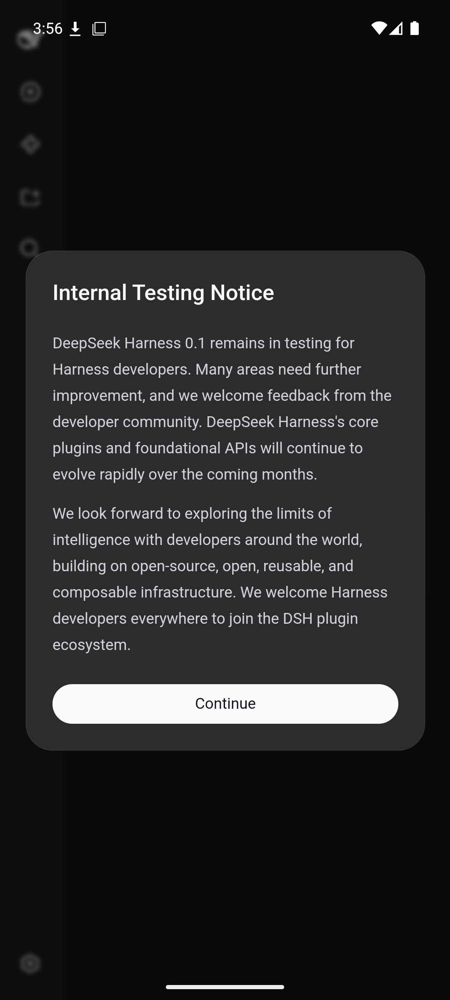
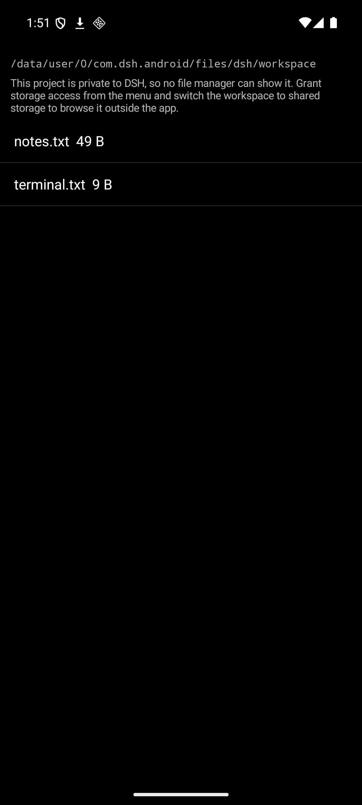

# Verification record

What was actually run, on what, and what it reported. Host: Windows 11, Ryzen 9
9950X3D, WSL2 Ubuntu 24.04. Device: the `dsh-android` Android Virtual Device
(Pixel 7, Android 16 / API 36, x86_64, Google APIs image, emulator 36.5.10).

## 1. Every runtime primitive, on the device

Run in the application's own environment, against the extracted runtime:

```
node    : v24.18.0 on android-x64
ripgrep : ripgrep 15.2.0
bash    : bash 5.3.9(1)-release
flock   : acquired the Session write lock
publish : published (no-clobber)
publish : second attempt refused with EEXIST
pty     : interactive shell answered on the PTY
```

| Line | What it proves |
|---|---|
| `node v24.18.0 on android-x64` | The Node executable runs from the APK's native library directory, resolves its shared libraries, and reports the Android platform |
| `ripgrep 15.2.0` | The bundled ripgrep executes, so `glob` and `grep` have a search binary |
| `bash 5.3.9` | The bundled bash executes, so the shell executor and the terminal have a real Bash rather than the platform's mksh |
| `flock : acquired` | The Node-API addon built against bionic loads and takes the Session write lock |
| `publish : published (no-clobber)` | The port's publication primitive creates a target Android's policy would not let `link(2)` create |
| `publish : … refused with EEXIST` | It still refuses to replace an existing file, which is the guarantee every caller depends on |
| `pty : answered` | node-pty, built for Android by this port, allocates a working pseudo-terminal and an interactive shell answers on it |

## 2. The Harness boots and serves

```
[runtime] installed 14620 entries
[runtime] …/lib/x86_64/libnode.so --expose-internals …/runtime/lib/bin.js web --host 127.0.0.1 --port 35237 --no-open
dsh web: http://127.0.0.1:35237/?token=PkZHO4hykvd6_F1HYxC3iJj0SSHV4bfuZO4KDf8twaA
```

and the process list while it runs:

```
u0_a216  6093   481  … com.dsh.android
u0_a216  6193  6093  … libnode.so
```

DSH's browser application renders inside the application's WebView from that
loopback origin — sidebar, workspace picker, agent-mode row, and composer:



## 3. A real agent turn, on the device

`dsh --profile headless` was given a task that requires the model, a shell, a
file write, and a search:

> Create a file named notes.txt whose only line is the output of the pwd command.
> Then use your search tool to confirm notes.txt contains that path.

The device's transcript, abbreviated:

```
dsh: reasoning: The user wants me to create notes.txt with the pwd output. Then
    "use your search tool" to confirm. My search tool is grep. Let me do it.
dsh: reasoning: Now create notes.txt with write tool. The only line is the path.
    Then grep to confirm.
notes.txt contains the single line
/data/user/0/com.dsh.android/files/dsh/workspace, confirmed with grep.
```

A second run, after the terminal was added, used a pipeline and the search tool
again: *"Ran `echo terminal | tee terminal.txt` … and grep confirmed
`terminal.txt` line 1 contains "terminal"."*

What it left behind, read back over `adb`:

```
files/dsh/workspace/notes.txt                    49 bytes
  /data/user/0/com.dsh.android/files/dsh/workspace

files/dsh/home/.dsh/sessions/--…--/session-1efad7b8-…/session.v3.jsonl.zstd
files/dsh/home/.dsh/sessions/--…--/session-5b8d83e0-…/session.v3.jsonl.zstd
```

One run exercises every layer at once: the model adapter streamed over the
device's own network, the agent loop drove three tool calls, the shell executor
spawned the bundled bash, the search tool spawned the bundled ripgrep, the file
tools wrote through the publication path, and the session log was published and
compressed to disk.

## 4. What each failure taught the port

In the order the problems appeared. Each is a property of the platform.

| Symptom | Cause | Resolution |
|---|---|---|
| The linker crashed inside `split_path` while preloading a library | Rewriting an ELF's dynamic string table to rename libraries (so the platform would extract them from `lib/`) produces an object Android's linker rejects | The executable ships as `libnode.so`; everything else keeps the file name its SONAME requires and is found through `LD_LIBRARY_PATH` |
| `Cannot find package '@deepseek-ai/cosmokit'` | pnpm keeps a `link:` workspace dependency as a symbolic link, and an APK cannot carry one | The vendored Cordis packages are copied in as real directories |
| `Cannot find module 'node-addon-require-builtin/…/require_builtin.node'` | That family publishes no Android binding, and its entry builds the binding during import | The loader reaches Node internals through `--expose-internals`; the entry is replaced with one that reports unavailability |
| 29 plugins "failed to import" | `pnpm deploy --prod` installs the deployed package's dependency closure, and the Harness declares its service definitions as peer dependencies | `scripts/complete-deployment.mjs` completes the peer closure from the workspace |
| `flock is not supported on android-x64` | The binding rejected every platform it had no payload for | `android-arm64` and `android-x64` payloads are built with the NDK and resolved like the other platforms' |
| `/…/nativelib/libz.so.1 is for EM_AARCH64 instead of EM_X86_64` | One archive serves every ABI, so an ABI's libraries cannot sit at its root | Each ABI's libraries live under `nativelib/<abi>/`, and the application points `LD_LIBRARY_PATH` at its own |
| `permission: the mounted bash executor does not confine` | The permission presets bundle a sandbox mode, so the plugin refuses to compose over an executor that does not confine — the only kind Android has | The row is gated off on Android; the file-effect modes stay selectable per session |
| `EACCES: permission denied, link …` on the first append and on the first guarded write | Android denies `link(2)` inside application data — the shell user cannot hard-link there either — and the Harness published session logs, attachments, and guarded writes by hard link | `publishNoClobber` in `@deepseek-ai/dsh-atomic-write` falls back to an exclusive create plus copy, keeping the no-clobber guarantee and the `EEXIST` answer |
| `grep` failed with "ripgrep launch failed" under `--profile headless` | Only the agent presets restated the deployment's ripgrep path, and the headless profile mounts the base row | The base row reads `DSH_RIPGREP_PATH`, so every profile gets it |
| The status and navigation bars covered the interface | Android 15 draws every application edge to edge; the activity placed the WebView across the whole window | The activity applies the system-bar and keyboard insets to its root view |
| `run_code` failed: "libnode.so needs libz.so.1, which is missing" | The `run_code` worker deliberately drops the ambient environment and keeps only the startup variables the child needs — and `LD_LIBRARY_PATH` is how an Android Node executable finds its libraries, so the child could not link | `LD_LIBRARY_PATH` and `TMPDIR` join that startup set, the same class as the `PATH` already there |
| The WebView showed "dsh web authentication required" | The application treated an answered request as readiness, and the server answers an unauthenticated request with 401 — so the port probe could win the race against the printed URL and load an origin with no token | Readiness is the printed URL itself, which is the only origin that activation authorizes |

## 5. The `run_code` worker, on the device

The PTC worker is a second Node process the Harness starts with a deliberately
emptied environment. Given only the startup variables the port now preserves, it
links and runs:

```
worker env: PATH,LD_LIBRARY_PATH,TMPDIR,TMP,TEMP
status : 0
stdout : worker linked: v24.18.0 on android
```

and a real turn that must use it — `DSH_TOOLS_MODE=ptc`, asked to print the
working directory and the value of six times seven — answered from inside the
worker:

```
dsh: reasoning: The user wants me to use run_code to print the current working
    directory and the value of six times seven. Let me do that.
(node:4076) ExperimentalWarning: stripTypeScriptTypes is an experimental feature …
The current working directory is /data/user/0/com.dsh.android/files/dsh/workspace,
and six times seven is 42.
```

## 6. With the screen off

The application holds a partial wake lock while the Harness runs, and the
platform confirms it:

```
PARTIAL_WAKE_LOCK  'dsh:harness' ACQ=-6m56s969ms LONG (uid=10216 pid=3014)
```

The Node process is alive after two minutes of a dark screen, and its processor
time advances while it is dark — 412 to 416 ticks over 90 seconds — so it is
being scheduled rather than frozen.

More to the point, the server still answers. Requested from the device itself,
with the screen off, twice, 105 seconds apart:

```
http    : 303 /
bytes   : 0
authenticated: true
```

The 303 is the token exchange the Web UI performs on load: the server accepted
the run's token and redirected, which is a full round trip through the runtime
while the device was dark.

## 7. Reaching the generated files

The workspace browser lists what the agent wrote — the two files from the turns
above — and the shortcut sits in the page's top-right corner:



Another application can read a project file through this application's provider,
which serves the workspace and refuses everything beside it:

```
content://com.dsh.android.files/notes.txt
  -> /data/user/0/com.dsh.android/files/dsh/workspace          (served)

content://com.dsh.android.files/../home/.dsh/.credentials.yaml
  -> FileNotFoundException: path outside the served subtree    (refused)

content://com.dsh.android.files/../runtime/lib/bin.js
  -> FileNotFoundException: path outside the served subtree    (refused)
```

The emulator image installs no application that handles `text/plain`
(`cmd package resolve-activity -a android.intent.action.VIEW -t text/plain`
answers "No activity found"), so opening a file end to end could not be observed
there; the browser falls back to sharing, which is what that device can do.

## 8. Opening the project from the application

The application's own row sits above the page, and the file dialog opens from a
file reference in a conversation:


The bridge between page and application was checked through the WebView's own
debug socket rather than by eye:

```
bridge installed   : true
DSHAndroid present : object
renderer saw the click: false      (the Harness's own handler did not receive it)
pending recorded: true             (kept for "Preview in DSH")
```

The click test used the markup the Harness renders for a file reference — a
`button` carrying the `fileLink` class with the path in `title` — which the
production stylesheet confirms survives bundling as `_fileLink_uddqf_59`.

`Project folder` reaches the device's file manager, inside the folder:


```
I DshMain : opening project folder /storage/emulated/0/DSH as
            vnd.android.document/directory resolvable=true
top: com.google.android.documentsui/com.android.documentsui.files.FilesActivity
breadcrumb: sdk_gphone64_x86_64 > DSH          "Files in DSH"
```

The same action reported `resolvable=false` until the manifest declared
`<queries>`: Android 11 hides packages an application has not asked about, so
the intent that the platform accepts from a shell resolved to nothing from the
application. No amount of intent tuning substitutes for that declaration.

## 9. Failure reporting

A fatal failure reaches the application's own log screen, checked by raising one
on purpose from the debug menu:

```
=== crash 2026-10-14 02:35:58 in main ===
java.lang.IllegalStateException: simulated failure, to check the crash recorder
	at com.dsh.android.MainActivity.onOptionsItemSelected(MainActivity.java:383)
	at android.widget.PopupMenu$1.onMenuItemSelected(PopupMenu.java:109)
	...
```

The same trace appears at the bottom of the **Log** screen, which is what makes
a failure on a device the developer does not hold reportable at all.

## 10. Moving a project to shared storage

Accepting the offer, or the *Move project to shared storage* action, copies the
private workspace into `/sdcard/DSH` without replacing anything:

```
before    files/dsh/workspace:        after    /sdcard/DSH:
          demo  notes.txt                      demo  notes.txt
          demo/a.txt  demo/sub/                demo/a.txt  demo/sub/
          demo/sub/b.txt                       demo/sub/b.txt
```

The copy is what makes the offer meaningful: changing the setting alone left the
new folder empty and the user's files in a directory no file manager reaches.

## 11. Where a new project actually goes

A project created through the Harness's directory picker does not land in the
application's workspace: the picker offers the Harness process home as *Home*,
so projects made there live under `files/dsh/home`. Granting shared storage now
moves the process home itself, read back from the running runtime:

```
HOME              = /storage/emulated/0/DSH
DSH_HOME          = /data/user/0/com.dsh.android/files/dsh/home/.dsh
TMPDIR            = /data/user/0/com.dsh.android/files/dsh/tmp
LD_LIBRARY_PATH   = /data/user/0/com.dsh.android/files/dsh/runtime/nativelib/x86_64
```

and the move action covers both places, keeping each project's own name:

```
/sdcard/DSH:            app-project  demo  myproject  notes.txt
/sdcard/DSH/app-project: index.ts                       (from the workspace)
/sdcard/DSH/myproject:   readme.md  src/main.js         (from the harness home)
```

The Harness's state directory is excluded by construction: it is a sibling of
those projects named `.dsh`, and it stays in the application's private storage.

## 12. Not verified

- **A physical Android device.** Only the x86_64 emulator was run. The arm64
  payload is built from the same sources by the same scripts, and the archive
  carries both ABIs' libraries and prebuilt bindings, but no phone was attached
  to this machine.
- **Image attachments and Office conversion**, which the Android surface does
  not mount; see the limitations in [../README.md](../README.md).
- **Multi-turn conversations and compaction** on the device. Two complete turns
  were run end to end; the surfaces those features use are the ones they
  exercised.
